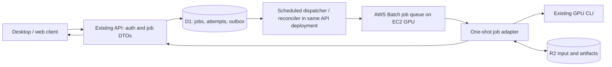

# Trackdub SnapSoft GPU POC: source assessment and proposed architecture

Status: **proposed; awaiting Michael's plan approval and SnapSoft scope/service alignment**. This document is an assessment, not an implementation or deployment authorization. No AWS resources were created, no paid workloads were started, and no application code was changed.

## 1. Evidence and repository truth

**Verified from the current checkout:** `/workspace/Trackdub`, branch `work`, commit `20b432e553956d570c45d96efd3915f8a2569da0`. The working tree was clean before these planning documents. GitHub `main` matched that commit at inspection. The supplied Windows workspace `D:\Dev\Trackdub_Workspace\Trackdub` is not attached here; its branch and uncommitted changes cannot be certified. Other attached Trackdub checkouts were not modified. Trackdub is the canonical name.

**Verified remotely:** the related private repository `trackdubllc/api.trackdub` exists. Its source was inspected read-only at commit `12ba3b519e3c8e83e54269d2a987a23723094e24`; this is a separate Cloudflare API, not an ASP.NET project in the core repository. See the pinned [API README](https://github.com/trackdubllc/api.trackdub/blob/12ba3b519e3c8e83e54269d2a987a23723094e24/README.md) and [job routes](https://github.com/trackdubllc/api.trackdub/blob/12ba3b519e3c8e83e54269d2a987a23723094e24/src/routes/dubs.ts). Deployed configuration, live job intake, D1 contents, R2 access, and production processing were not tested.

**Verified CI evidence, not independently rebuilt:** [Container Image run 39558417628](https://github.com/trackdubllc/Trackdub/actions/runs/39558417628) succeeded for both `rtx` and `server` at source commit `563ece3eca0dec7fb1889e879aa5ac09e9bb6492`. Each profile's build/publish, authenticated pull, and runtime verification steps succeeded. The server log records:

```text
ghcr.io/trackdubllc/trackdub:sha-563ece3eca0dec7fb1889e879aa5ac09e9bb6492-server
sha256:792793923533bb7660b057eda44d01c77d04a1bf66d9133683fab2d8ab78d3f7
```

There is no diff from that image source to the inspected HEAD in `Dockerfile`, `src`, `docker`, `scripts/docker`, or the container workflow. This does not relabel the published image as HEAD or prove a HEAD-tagged image exists. CI deliberately expects `doctor` exit `2` with no seeded weights; it proves packaging/tools and a writable model cache, not GPU or pipeline success.

**Observed registry limitation:** an anonymous GHCR pull-token request for `repository:trackdubllc/trackdub:pull` returned HTTP `401` from this environment. No layers were downloaded. CI's authenticated pull works; anonymous/AWS-host pullability is unresolved. This response does not prove that any requested tag is missing. SnapSoft must validate the agreed authentication or ECR mirror from the actual execution environment.

**Documented but not independently rerun:** `docs/operations/cloud-gpu-container.md` records local RTX 5070 provider probes, classic TensorRT cache fixes, and cache reuse across fresh containers. It also records process crashes and smoke limitations. Raw evidence is described as local and uncommitted. No target AWS GPU end-to-end or persistence acceptance was established here. No local build/test was run for this read-only assessment; `dotnet` is not on PATH in this environment. No GPU/model downloads or containers were run.

The repository asks for `trackdub-docs-rag`; no such callable tool was available. Current source and checked-in documentation were used directly.

### Current source map

All core paths below are relative to `/workspace/Trackdub`.

| Concern | Exact path / symbol | Verified behavior and implication |
|---|---|---|
| Container | `Dockerfile` stages `build`, `runtime-base`, `rtx`, `server` | Linux x64 .NET 10, non-root UID/GID 10001; CUDA 13, cuDNN, TensorRT 10.13.3.9, FFmpeg, eSpeak. CLI entrypoint `dotnet Trackdub.Cli.dll --model-directory /data/models`; default `doctor`. GPU ORT core and base GenAI native library copied explicitly during build. |
| Profile distinction | `Dockerfile`; `scripts/docker/seed-and-warm-gpu-worker.sh` | Image targets share runtime contents and differ by `TRACKDUB_GPU_PROFILE`. The marker selects provisioning behavior in the script; no C# consumer of that marker was found. It is not itself a runtime per-stage provider pin. |
| Compose | `docker-compose.yml`; `docker-compose.aws.yml` | One-shot `restart: "no"`, GPU passthrough, init, 30-second stop grace. AWS selects `server`, defaults to `main-server`, binds `/mnt/trackdub-data` to `/data`. Input/output/log/LinML mounts remain separate. Compose is a manual host runbook, not a Batch/ECS task definition. |
| Context hygiene | `.dockerignore` | Excludes local secrets, model/media/database/log/build state; permits required Olive helper, runtime manifest, and native build target. |
| CLI binding | `src/Trackdub.Cli/Program.cs::BuildRootCommand`; `Commands/RunCommand.cs`; `Commands/RunPipelineCommandOptions.cs`; `Commands/RunPipelineCommandExecutor.cs::ExecuteAsync` | Global model/provider/progress options; `run pipeline --media ... --source-language ... --target-language ... --output ...`. `--output` is a project directory, not the exported media filename. Redirect stdin for unattended use. |
| Host adapter | `src/Trackdub.Cli/Handlers/RunPipelineHandler.cs::ExecuteAsync` | Takes `RunPipelineRequest`, acquires a project lock, maps to `DubbingSessionOptions`, calls the shared engine, writes a manifest and JSON stdout summary. Pipeline cancellation currently returns `2`. |
| SDK/application | `src/Trackdub.Sdk/TrackdubDubbingEngine.cs::ExecuteAsync`; `src/Trackdub.Application/Dubbing/DubbingPipelineEngine.cs::ExecuteAsync` | SDK is a thin wrapper; application owns preflight, stage orchestration, export, outcome aggregation. Reuse rather than copy into controllers. |
| Composition | `src/Trackdub.Cli/CliParseHelpers.cs::ApplyModelDirectory`; `src/Trackdub.Sdk/TrackdubBuilder.cs::Build`; `Sdk/Composition/HeadlessCompositionRoot.cs::AddHeadlessTrackdub`; `Composition/Headless/HeadlessCompositionRoot.cs::AddHeadlessTrackdub`; `HeadlessDubbingSessionFactory.CreateSession` | Headless DI replaces playback, scopes per-project services/settings, applies model/storage overrides, binds session pool admission. |
| Typed execution | `src/Trackdub.Contracts/Dubbing/DubbingSessionOptions.cs`; `DubbingRunResult.cs`; `StageOutcome.cs` (same directory) | Result carries run/correlation IDs, times, stage outcomes and artifacts, provider/model snapshot and preflight failures. Run statuses: `Succeeded`, `PartialSuccess`, `Failed`, `PreFlightFailed`; no cancelled run result today. |
| Progress | `src/Trackdub.Contracts/Pipeline/PipelineProgressEvent.cs`; `src/Trackdub.Application/Pipeline/RunScopedProgressReporter.cs`; `src/Trackdub.Cli/CliProgressReporter.cs::Report` | Typed stage events with nullable percent, run ID and sequence. `--progress json` emits JSON lines to stderr, which can also contain diagnostics; it is not a clean, versioned cloud protocol. |
| Manifests/errors | `src/Trackdub.Sdk/RunManifestWriter.cs::WriteAsync`; `src/Trackdub.Cli/CliErrorReporter.cs`; `src/Trackdub.Sdk/ErrorCode.cs` | Latest and historical run JSON exist, but manifest I/O errors are swallowed and writes are not atomic. stdout summary names a manifest even if writing failed. Do not use this best-effort file as sole durable completion proof. |
| Cancellation | `src/Trackdub.Cli/Program.cs` exit constants; `RunPipelineHandler.ExecuteAsync`; application `CancellationToken` propagation | Codes are 0 success, 1 argument error, 2 pipeline failure, 130 uncaught cancellation. Handler catches pipeline cancellation and returns 2; no proven container SIGTERM-to-cooperative-token contract. Forced native termination can bypass all result writing. |
| Persistence | `src/Trackdub.Infrastructure/Persistence/Sqlite/SqliteProjectDatabase.cs`; `src/Trackdub.Composition/CompositionRoot.cs`; `src/Trackdub.Contracts/Projects/ProjectArtifactPaths.cs` | Project-local `<project>/trackdub.db`, WAL, scoped repositories/stage runs. Not a cloud job queue. |
| Storage/env | `src/Trackdub.Composition/Headless/HeadlessPersistedEpLicenses.cs::ResolveStoragePaths`; `src/Trackdub.Infrastructure/Settings/TrackdubStoragePathResolver.cs`; `TrackdubStoragePaths.cs` | With CLI model directory `/data/models`, headless data/cache roots derive there; logs/settings/index are not necessarily in `/logs`. Explicit `TRACKDUB_ENGINE_CACHE_ROOT=/data/engine-cache` is honored. No C# consumers found for `DATABASE_PATH`, `MODELS_CACHE_DIR`, `AUTO_DOWNLOAD_MODELS`, or `ONNX_PROVIDER`; model directory and provider CLI options are effective controls. |
| Lock/concurrency | `src/Trackdub.Sdk/ProjectLock.cs::Acquire`; `src/Trackdub.Infrastructure/Persistence/Repositories/LocalModelCacheRecordStore.cs::MutateAsync`; `src/Trackdub.Infrastructure/Settings/TrackdubStoragePathResolver.cs::ApplyToCurrentProcessScoped` | Project file lock protects a directory on a supporting filesystem. Cache index lock is instance-local; process environment is shared. No distributed job claim or fleet-safe shared cache mutation is established. |
| Session reuse | `src/Trackdub.Inference.Onnx/Pool/InferenceSessionPool.cs::Shared`; `SharedPoolOptions.cs`; `src/Trackdub.Composition/Pipeline/ResidentWarmupService.cs` | Process-local pool; sessions serialized per lease and subject to eviction. Current GPU budget is 75% at/below 16 GiB, 85% above, clamped 4096–65536 MiB. Linux headless telemetry lacks the default Windows process-isolated GPU reader; reservation accounting is not coordination across containers. |
| Existing workers | `src/Trackdub.Cli/Handlers/ServeHandler.cs::ServeAsync`; `src/Trackdub.Contracts/Serving/IResidentInferenceHost.cs`; `src/Trackdub.InferenceWorker/Trackdub.InferenceWorker.csproj` | `serve` is a resident tensor-inference JSON stdin/stdout protocol, not media-job HTTP or a durable queue consumer. `InferenceWorker` is a Windows CUDA isolation executable, not the AWS job worker. |

### Existing cloud API changes the baseline

In `trackdubllc/api.trackdub` at the pinned ref:

| Exact file / symbol | What exists | What is missing |
|---|---|---|
| `src/index.ts` | Hono/Cloudflare Worker, Better Auth, CORS, mounted `/api/dubs` | Scheduler/consumer and scheduled reconciliation |
| `src/routes/dubs.ts` (`dubs`) | Authenticated multipart upload; create/list/get; ownership filter; DELETE cancellation; completed download | Durable dispatch intent/idempotency, GPU execution, honest running cancellation, artifact listing |
| `src/db/schema.ts::dubJobs` | D1 durable `dub_jobs` rows | Attempts, leases, outbox, version/CAS, deadlines, structured terminal evidence |
| `src/lib/dubs.ts::DUB_JOB_STATUSES`, `toDubJobDto`, `MAX_UPLOAD_BYTES` | `Queued/Running/Completed/Failed/Cancelled`; portal DTO; 100 MiB upload cap | Rich state/phase and result contracts; portal's larger upload promise is not supported |
| `src/lib/capabilities.ts::isDubProcessorReady` | Intake/upload require `DUB_PROCESSOR_ENABLED === "true"` | Evidence of a deployed processor; flag alone proves no processing capability |
| `src/types/env.ts::Bindings` | `DB`, `MEDIA` (R2), auth configuration | AWS scheduler bindings/credentials and internal adapter authentication |
| `src/lib/errors.ts::ApiError`, `toErrorBody` | Existing safe `{error:{code,message,requestId,details?}}` | Stable job execution error taxonomy |

Creation currently durably inserts a Queued row and returns 201, with no dispatch. Cancellation immediately writes terminal Cancelled for Queued/Running; that will be incorrect once real execution exists. No Batch, ECS, SQS, S3/DynamoDB job adapter was found in core or these API source surfaces. D1/R2 integrations already exist. Reuse them provisionally rather than add a second API/auth system or second authoritative job database.

### Linux boundaries

Portable `net10.0` targets exist alongside conditional Windows targets. `Trackdub.Composition.csproj` includes `InferenceWorker` only for the Windows target. Headless composition removes playback services. Windows ML catalog/DirectML, Windows DXGI/per-process telemetry, Windows inference isolation, and Windows-only optional effects cannot be acceptance prerequisites on AWS Linux. CUDA/classic TensorRT use Linux routes. No unconditional Windows dependency blocking the inspected CLI Linux path was found, corroborated by CI runtime checks; this is not proof every optional stage works on Linux. Keep lip repair, desktop playback, Windows-specific effects and telemetry out of the initial job preset.

## 2. Recommended architecture (proposed)

Prefer **existing lightweight API + durable job/outbox + AWS Batch on EC2 GPU + a small supervisor around the existing one-shot CLI**. Final Batch versus ECS choice remains with SnapSoft delivery alignment. Keep the client contract and adapter independent of that choice.



No SQS, Step Functions, Kubernetes, Redis or separate always-on dispatcher is required for this baseline. Use a scheduled handler in the existing Worker for bounded outbox dispatch and reconciliation. For POC traffic, dispatch cadence of one minute is acceptable unless Michael requires lower queue latency. A request may trigger a best-effort immediate dispatch after durable commit; correctness must not depend on that request or `waitUntil` surviving.

This is a **cross-cloud proposal**, not a claim about the AWS-funded SOW. If SnapSoft requires AWS-only API/storage, use a lightweight ASP.NET CPU host, one DynamoDB job/outbox store, S3, and the same Batch/CLI adapter; explicitly supersede/migrate the API scaffold rather than run two authoritative job systems. Resolve this before implementing host-specific code. Do not install a GPU runtime in the client API. API host reuse refers to job control only; execution remains in shared application/SDK services behind the CLI host.

### Alternatives

AWS Batch supplies a managed job-scheduling layer over container orchestration, including ECS/EKS; it is not unrelated to ECS. The proposed comparison is Batch job semantics versus direct ECS task orchestration. [AWS Batch overview](https://docs.aws.amazon.com/batch/latest/userguide/what-is-batch.html)

| | A. Batch + one-shot CLI | B. Direct ECS one-shot task | C. Long-lived GPU queue consumer |
|---|---|---|---|
| Fit | Best match for finite CLI jobs | Equally compatible with CLI | Reuse `TrackdubDubbingEngine`/application in-process; new consumer host |
| New code | Outbox dispatcher/reconciler, supervisor, API/job contract | Same plus application-owned queue/capacity/retry task logic | Lease/visibility loop, per-job DI/reset, graceful draining, crash recovery and resident-session management |
| Infrastructure | Job queue/definition, GPU EC2 compute environment, IAM/storage/logging | ECS GPU cluster, task definition, capacity provider, job dispatch infrastructure | GPU ECS service plus durable queue/claim store; service scaling/draining |
| Sessions | Lost when CLI process exits | Lost when CLI process exits | Can remain in one shared process; pool may evict; some backend sessions may need separate validation |
| Engine cache | Persistent host `/data`; same identity required | Same | Same; distinct from resident sessions |
| Idle GPU | Can reduce capacity to zero with cold start/cache implications; warm minimum costs while idle | Task exit does not stop EC2; explicit capacity scaling required | Resident process retains GPU allocation; idle cost until service/host scales down |
| Retry | Managed Batch attempt policy exists, but business retries/duplicate effects still need control | Own logical retry policy; `RunTask` has `clientToken` | Own retry/backoff, poison-job handling, lease recovery |
| Cancel | Terminate/cancel Batch job and reconcile actual cessation | `StopTask` plus cooperative adapter cancellation and reconcile | Per-job token; drain or terminate host if native code hangs |
| Scope risk | Lowest execution change; bootstrap/persistence still real work | Good if SnapSoft already has ECS POC; more scheduler behavior owned by app | Highest POC scope and state-isolation risk |

GPU task placement needs GPU-capable EC2 capacity and GPU resource reservations; do not select Fargate for this GPU workload. [ECS GPU task guidance](https://docs.aws.amazon.com/AmazonECS/latest/developerguide/ecs-gpu.html), [Batch GPU jobs](https://docs.aws.amazon.com/batch/latest/userguide/gpu-jobs.html). Direct ECS task submission supports a client token; use it for each dispatch. [RunTask](https://docs.aws.amazon.com/AmazonECS/latest/APIReference/API_RunTask.html)

## 3. Minimal POC and deferred scope

**Include:** one authenticated principal using existing auth; one immutable uploaded video per job; one fixed server preset; EN→ES first; one GPU job at a time on the dedicated POC host; bounded queue/runtime; durable acceptance, status polling, cancellation, error classification, artifact download; restart/duplicate safety; pinned image/models; documented host provisioning, seeding and cache warming. EN→ZH/voice cloning is a separate acceptance fixture only if explicitly agreed and supported by the selected model/voice route.

**Defer:** persistent media-job worker, cross-job resident-session tuning, parallel GPU jobs, multi-GPU scheduling, fleet-wide writable caches/SQLite, streaming/websocket progress, arbitrary model/provider/stage options from clients, multi-GB upload overhaul, billing/usage metering, Spot optimization, automatic project resume across lost hosts, formal benchmarking and cost analysis. Timing startup/loading during functional diagnosis is permitted; it is not a comparative performance/cost deliverable.

The SOW removal of “Benchmarking and Cost Analysis” and removal of Michael's $2,000 contribution are **user-reported proposed changes awaiting SnapSoft confirmation/revised paperwork**. Nothing inspected proves those changes were accepted or that API/adapter delivery is in scope.

## 4. Proposed job/API contract

Keep existing `/api/dubs` routes compatible. Add versioned `/jobs` routes as aliases over the **same service and records**, not a second implementation. Version new DTOs with `schemaVersion: 1`; `/api/dubs` maps Completed to the new succeeded state and maps internal phases to existing Queued/Running display status. Add `phase` and `cancelRequested` so legacy UI does not falsely show stopped execution. Coordinate portal compatibility before changing DELETE semantics.

### Request and response types

```ts
type JobState = "accepted" | "queued" | "running" | "cancelRequested"
  | "succeeded" | "failed" | "cancelled" | "timedOut";
type JobPhase = "dispatching" | "starting" | "staging" | "pipeline" | "publishing";
type CreateJobRequest = {
  schemaVersion: 1;
  projectName: string;                 // display only; never a filesystem path
  input: { uploadId: string };         // server-owned immutable upload record
  sourceLanguage: "en";
  targetLanguage: "es";               // add zh only with qualified fixture
  preset: "poc-server-v1";
};
type JobProgress = {
  attemptId: string; runId: string | null; sequence: number;
  stageKey: string | null; phase: string | null;
  percentComplete: number | null; updatedAt: string;
};
type JobError = {
  code: string; message: string; retryable: boolean;
  stageKey: string | null; correlationId: string;
};
type ArtifactRef = {
  id: string; kind: "video" | "subtitle" | "runResult" | "diagnostic";
  fileName: string; contentType: string; sizeBytes: number; sha256: string;
  available: boolean; downloadUrl?: string; expiresAt?: string;
};
type JobResult = {
  schemaVersion: 1; runId: string;
  pipelineStatus: "succeeded" | "partialSuccess";
  warnings: string[]; artifacts: ArtifactRef[];
};
type JobDto = {
  schemaVersion: 1; id: string; state: JobState; phase: JobPhase | null;
  attemptId: string | null; attemptNumber: number; version: number;
  createdAt: string; updatedAt: string; startedAt: string | null;
  completedAt: string | null; cancelRequestedAt: string | null;
  queueDeadlineAt: string; executionDeadlineAt: string | null;
  progress: JobProgress | null; result: JobResult | null; error: JobError | null;
};
```

IDs are opaque server-generated UUIDs. Logical `jobId`, scheduler `executionId`, application `runId`, and each `attemptId` are distinct, stored and correlated. Clients cannot choose attempts, scheduler definitions, image, commands, environment variables, arbitrary URLs, or local paths. The request fingerprint includes immutable input identity/hash, normalized languages and preset **version**.

| Endpoint | Proposed semantics |
|---|---|
| `POST /jobs` | Require auth and `Idempotency-Key`; validate staged input and capability. Return `202` with `{job: JobDto}`, `Location: /jobs/{id}`, `Retry-After: 5` **only after** one atomic D1 batch durably records job, idempotency mapping and outbox intent. Replay same key/body returns original job; same key/different body returns 409. Unavailable store/disabled processor returns 503 with no acceptance. |
| `GET /jobs/{id}` | Return 200 owned job; 404 for absent or other owner's job. Poll interval hint; optionally ETag using `version`. No request waits for the pipeline. |
| `POST /jobs/{id}/cancel` | Idempotent. Terminal cancelled returns 200; other terminal states return 409. Unlaunched accepted job can atomically cancel/delete pending intent. Otherwise record `cancelRequested` and durable cancel intent, return 202; report cancelled only after execution is confirmed stopped. |
| `GET /jobs/{id}/artifacts` | Return 200 `{items: ArtifactRef[]}` for owned jobs, empty until artifacts are committed; failure diagnostics may be listed separately. Issue fresh short-lived download capabilities on request, never persist signed URLs as durable identity. |

The existing `/api/dubs/upload` may remain for the POC, with its verified 100 MiB limit. Add immutable upload records and checksum metadata; clients submit `uploadId`, while legacy `inputMediaPath` is resolved/validated server-side. Enforce ownership, existence, bytes, allowed media, duration/resolution limits and allowed language/voice pairs. Validate actual media with ffprobe in the adapter, not filename extension alone. Accept no remote fetch URLs or user-controlled destination keys. Configure explicit POC limits before intake is enabled; proposed fixture ceiling is 100 MiB/5 minutes/1080p, subject to Michael's approval. Advertised supported language lists do not prove actual model coverage.

Reuse Better Auth/session authorization and existing CORS. Cross-origin clients need `Idempotency-Key` allowed by CORS. Desktop authentication is unresolved: use an agreed supported authenticated session flow for POC; do not expose an admin token or invent a second identity system. Worker-control routes use a separate authenticated service identity and job/attempt-bound capabilities; browser sessions cannot claim or complete jobs.

Reuse the current API error envelope `{error:{code,message,requestId,details?}}`; define codes `INVALID_INPUT`, `INPUT_CHANGED`, `IDEMPOTENCY_CONFLICT`, `PREFLIGHT_FAILED`, `PIPELINE_FAILED`, `WORKER_CRASHED`, `RESULT_MISSING`, `ARTIFACT_UPLOAD_FAILED`, `QUEUE_TIMEOUT`, `EXECUTION_TIMEOUT`, `CANCELLED`. Client-safe messages omit credentials, local paths and stack traces; diagnostics remain access controlled.

### Durable ownership, dispatch, retries and restarts

D1 owns business job state. Batch/ECS owns execution facts. Local project SQLite owns pipeline/project state; it is not a distributed job store. R2 owns immutable inputs/output objects. No AWS job ID or scheduler status alone is the client result.

1. Use one atomic D1 `batch()` for acceptance and outbox insert, backed by unique `(ownerId, idempotencyKey)` and `(jobId, dispatchId)` constraints. Keep mappings at least as long as the job; no automatic POC TTL that silently permits duplicate submissions. D1 batches roll back as a unit on statement failure. [D1 batch API](https://developers.cloudflare.com/d1/worker-api/d1-database/)
2. Scheduled dispatch claims pending intents with conditional updates and a bounded lease. It submits a fixed image/definition with opaque IDs, records execution ID, then acknowledges the intent. Retry transient dispatch calls with capped exponential backoff and jitter.
3. Batch `SubmitJob` does not expose a client idempotency token. A lost submit response can create duplicate scheduler jobs; a deterministic job name is not deduplication. Persist `dispatchId`, discover/reconcile matching jobs, and require a **conditional start claim before downloading or invoking CLI**. Only one execution may claim the logical attempt; losers exit without executing. Record every discovered execution ID and terminate duplicates. [SubmitJob API](https://docs.aws.amazon.com/batch/latest/APIReference/API_SubmitJob.html)
4. Attempt claims are bound to execution identity and monotonically increasing fencing generation. Heartbeats/progress/results must match the active attempt/generation. Lease expiry stops an isolated adapter; it does not by itself authorize another pipeline on a possibly live old container. Reconcile/terminate the old execution before replacement. A stale writer can only leave orphan attempt objects, never publish the job result.
5. Start with **Batch `retryStrategy.attempts = 1`**. The control plane may authorize one replacement attempt (two total) only for confirmed host loss or transient staging failure; do not retry model/configuration/native crash/pipeline errors automatically. This avoids two independent retry owners. Artifact upload/callback retries stay within the attempt and do not rerun the pipeline. Batch does have native retry support; broader use is deferred. [Batch retry behavior](https://docs.aws.amazon.com/batch/latest/userguide/job_retries.html)
6. Proposed deadlines: queue acceptance-to-start 3600 seconds; execution staging-through-publication 7200 seconds; heartbeat every 15 seconds, claim lease 90 seconds; latest progress snapshot at most once per 5 seconds plus stage transitions. These are operational limits to confirm, not performance promises. Separate queue deadline because Batch attempt timeout starts at RUNNING and excludes queue/startup. Reconcile starting/image-pull hangs against the queue deadline. Set Batch timeout as a backstop and enforce the application deadline in the adapter. [Batch timeout behavior](https://docs.aws.amazon.com/batch/latest/userguide/job_timeouts.html)
7. API restart loses no accepted work; scheduled dispatch resumes persisted intent. CLI/container death is reconciled using scheduler terminal facts and any uploaded result; the job cannot remain Running forever. Lost result publication is repaired from attempt objects. Successful upload followed by control-plane outage is retried without re-execution; no terminal success is exposed before artifact verification and final state commit.
8. Upload output and typed result to immutable `jobs/{ownerId}/{jobId}/attempts/{attemptId}/...` keys. The adapter reports a candidate completion and exits. Reconciler commits success only after adapter/scheduler exit 0, valid strict CLI result, required artifacts verified, and a CAS confirms the current attempt and no winning cancellation. R2 objects do not need a transaction with D1: upload first, commit references second, clean unreferenced objects later.
9. Cancellation and completion serialize through CAS. A completion committed first stays succeeded and cancel gets 409. A cancel intent committed first blocks success publication, stops the execution, then becomes cancelled. Duplicate cancel/callback/event requests are safe. Batch `CancelJob` only cancels pre-start jobs and can return success without stopping Running jobs; `TerminateJob` handles starting/running and also pre-start jobs. Verify terminal cessation rather than HTTP status. [CancelJob](https://docs.aws.amazon.com/batch/latest/APIReference/API_CancelJob.html), [TerminateJob](https://docs.aws.amazon.com/batch/latest/APIReference/API_TerminateJob.html)
10. The adapter observes cancel intent during heartbeats and forwards cooperative cancellation to CLI; explicit SIGTERM handling forwards shutdown and reaps FFmpeg/native child processes. Use a 20-second internal grace within the 30-second container stop window, then terminate the process tree; scheduler reconciliation supplies final state if the adapter is killed before callbacks. Exit 137/143 alone cannot distinguish user cancel, timeout or host failure; consult durable intent and scheduler reason.

No exactly-once computation guarantee is claimed. Conditional claims and fenced publication prevent concurrent authorized attempts and duplicate committed results; a crash after computation but before durable evidence may require a fresh attempt.

## 5. Proposed worker boundary

### Existing representative CLI invocation (source-verified syntax; not executed)

After staging a known video as `/work/input/source.mp4`, run inside the server image:

```bash
dotnet /app/Trackdub.Cli.dll \
  --model-directory /data/models \
  --execution-provider cuda --require-execution-provider \
  --progress json \
  run pipeline \
  --media /work/input/source.mp4 \
  --source-language en --target-language es \
  --output /work/output/job.trackdub \
  --export-format mp4 \
  </dev/null
```

With the image entrypoint, pass only the arguments after its built-in model-directory arguments. In Compose use `run --rm -T ...` and redirect stdin. The CUDA hard pin applies where the stage permits CUDA; it does not promise every operation runs on GPU (Silero/CPU vocoder routes remain legitimate). This is a representative executable command, not a fully qualified preset: before acceptance, pin the selected stage model aliases/variants in `poc-server-v1` and prove those resolve to the seeded Parakeet/MADLAD/Kokoro route. Existing `--model stage:alias` accepts overrides; do not assume seeding a variant forces planner selection. For mixed classic TensorRT/CUDA acceptance, qualify a reviewed stage map through existing `DubbingSessionOptions.ExecutionProviderPreferences`; the current pipeline CLI does not directly expose that dictionary. Do not globally require TensorRT for Kokoro/CosyVoice.

Current expected outputs at that project root are:

- `exports/dubbed.mp4` (`DubbingPipelineEngine.ResolveExportOutputPath`), not necessarily `artifacts/export/` despite the generic path constant.
- `run-manifest.json`, `run-manifests/run-{runId}.json` (best effort today).
- `trackdub.db` and potentially WAL/SHM while open; project `manifest.json`, media/intermediate/stage artifacts, subtitles as reported by stage outcomes.

Required execution prerequisites: seeded manifest-pinned weights, working FFmpeg/ffprobe/eSpeak, NVIDIA device/driver passthrough and compatible CUDA/TensorRT libraries, writable job workspace and correct UID/GID. Effective variables include `TRACKDUB_ENGINE_CACHE_ROOT=/data/engine-cache` and `TMPDIR=/work/tmp`. Admission overrides `TRACKDUB_SESSION_VRAM_BUDGET_MB` / `TRACKDUB_SESSION_RAM_BUDGET_MB` are optional operator settings; do not copy the historical 14000 MB workaround to an AWS GPU or disable admission. `TRACKDUB_GPU_PROFILE=server` selects provisioning. Legacy `ONNX_PROVIDER=cuda` cannot replace CLI provider arguments. Server provisioning needs no TensorRT-RTX plugin/license flag; preserve ordinary provider/model license obligations and notices.

### Minimum new adapter and machine contract

Create one small `.NET 10` supervisor host `Trackdub.CloudJobAdapter` that claims the job, resolves short-lived input/output capabilities, downloads/verifies input, invokes **the same CLI**, tails a dedicated progress file, uploads whitelisted outputs, reports candidate outcome, and exits. Use `ProcessStartInfo.ArgumentList` with fixed executable/subcommand/options; never `sh -c`, command interpolation or client-supplied env/options. Generate all local names from server IDs. Constrain exported artifact paths to the job root and reject symlink/path escapes before upload.

Do not replace the existing `server` entrypoint. A small derived `Dockerfile.cloud-worker` packages the supervisor atop an explicitly pinned server digest and changes the entrypoint only for the job-adapter image. It contains the same CLI pipeline implementation. Pin and record both base and adapter image digests.

Per attempt:

```text
/data/models/                              persistent seeded models/index/settings
/data/engine-cache/                        persistent identity-scoped engine cache
/work/input/{jobId}/{attemptId}/source.mp4  private staged input
/work/output/{jobId}/{attemptId}/project/   private project, SQLite and exports
/work/output/{jobId}/{attemptId}/result.json strict machine result
/work/output/{jobId}/{attemptId}/progress.jsonl dedicated typed progress
/work/tmp/{jobId}/{attemptId}/              private temporary files
```

Add `--result-file` and `--progress-file` to `run pipeline`; keep existing stdout/stderr behavior for CLI users. Result-file schema v1 is a `WorkerRunOutcome` with `schemaVersion`, `status` (`succeeded/failed/cancelled`), optional existing `DubbingRunResult`, stable `errorCode`, client-safe message, required-artifact inventory and warnings. Write a temporary file then atomically rename within the same directory. Successful pipeline execution with result-write failure must exit nonzero. Failure/cancel result writing uses an independent bounded cleanup token, not the already cancelled pipeline token. Each JSONL event wraps existing `PipelineProgressEvent` with schema version; the supervisor adds job/attempt identity. The result is local process evidence, not cloud terminal status by itself.

| CLI/process evidence | Adapter/control-plane meaning |
|---|---|
| Exit 0 + strict success result + required export verified | Candidate success; final success still waits for uploads and scheduler exit 0 |
| Exit 0 + partial success | Accept only if required export and preset-required stages achieved their goal; expose degradations/warnings; required-stage skip/failure is failure |
| Exit 0 + missing/malformed result | `RESULT_MISSING`/contract failure; never infer success from printed text or old manifest |
| Exit 1 | Invalid request/config/argument; nonretryable |
| Exit 2 | Preflight/pipeline/result-write failure; use typed reason if present, otherwise generic nonretryable failure |
| Exit 130 / typed cancelled | Cancel only with durable cancel intent; timeout if deadline caused it; unexpected interruption otherwise |
| Exit 134/139, signal, OOM or host death | Crash/infrastructure failure; a previously printed success summary cannot override abnormal exit |
| Missing final callback | Reconciler observes scheduler stop/result objects and supplies durable failure/cancel/timeout |

Current cancellation behavior must be normalized to 130 at the pipeline handler. Explicit Linux SIGTERM handling and process-tree shutdown need implementation and verification; existing `CancellationToken` signatures do not prove signal handling works.

### Concurrency and persistence constraints

POC: **one active GPU job per host, one reserved GPU per task, serial seed/warm operations**. Per-process auto budgets do not divide VRAM among containers; two workers could each reserve 85% of the same card. Set scheduler reservations/capacity accordingly. Different jobs use different project roots/databases. Do not put a shared WAL SQLite project database on EFS/NFS. Project file locks do not provide a fleet lease. Do not seed, prune, warm, or mutate the model index concurrently with jobs until cross-process safety is established.

EBS persistence in the current override means survival across containers **on that mounted host**. It does not mean Batch can move the same volume/cache to a replacement instance automatically. Initial acceptance covers container replacement on a prepared host; lost-host recovery re-seeds/re-warms unless SnapSoft explicitly implements same-AZ reattachment. Keep durable client artifacts in object storage. Copy/back up a project SQLite DB only after closing connections/checkpointing or through SQLite backup APIs; uploading only a live `.db` can omit WAL data.

Engine-cache reuse is conditional on GPU model/architecture, driver, TensorRT binary identity, ORT version, model/export and applicable shape/provider options. Source disables reuse when necessary identity is missing. Do not share compiled cache across incompatible GPUs. Persistent files reduce compile work; only a persistent process can preserve loaded sessions, and the pool can still evict them.

## 6. Proposed responsibility matrix

**Every allocation below is proposed and unconfirmed.** No row asserts an existing SnapSoft SOW obligation.

| Deliverable | Proposed Trackdub responsibility | Proposed SnapSoft responsibility |
|---|---|---|
| API host / DTOs | Own product contract, auth integration, compatibility and API code | Confirm hosting/funding fit, network access and deployment integration |
| CLI/shared application | Own machine output, cancellation normalization, preset/model selection and Linux fixes | Review deployability and report target-host failures |
| Job adapter | Own supervisor implementation and application tests | Integrate execution identity, credentials, task entrypoint and operational validation |
| Scheduler/task definitions | Define job states, retry/deadline requirements and scheduler interface | Recommend Batch/ECS; implement task/job definitions, GPU placement/capacity limits |
| Artifact storage/access | Define artifact inventory, authorization, immutable keys and retrieval behavior | Confirm R2/S3 boundary, network/IAM integration, retention and transfer operation |
| IAM/secrets | Define application permissions; configure existing API secrets with approved process | Own AWS roles, execution/task role separation, secret delivery/rotation and registry pull access |
| GPU host/AMI/drivers | Supply compatibility pins and diagnostics | Provision/validate approved GPU AMI, driver/toolkit, GPU agent support |
| Model seeding/warming | Own pinned model lists, verification logic and notices | Automate prepared-host storage/bootstrap, capacity and warm procedure on agreed target |
| Persistent storage | Define model/cache/project durability and concurrency requirements | Own EBS sizing/mount/permissions/lifecycle and any agreed replacement-host recovery |
| Logging/status | Own typed events, error mapping and durable business state | Own AWS logs/retention, scheduler telemetry and correlation integration |
| Deployment/IaC | Own app release/versioning and existing Cloudflare configuration | Own agreed AWS IaC/deployment/handoff; identify CF changes outside their scope |
| Functional acceptance/handoff | Supply licensed fixture, expected artifacts/criteria, sign off behavior | Run agreed AWS validation, capture reproducible evidence, deliver runbook/IaC and handoff |

## 7. Functional acceptance (proposed, separate from benchmarking)

Use a short licensed non-silent English MP4 fixture with a checked-in expected checksum and known speech. Empty/silent media can export successfully without dubbing, so it cannot establish ASR/translation/TTS success. EN→ES is the first test; EN→ZH/voice clone requires a separately specified fixture/consent and supported route.

- [ ] Record core commit, API commit, server image digest, adapter image digest, task/job-definition revision, AWS region/instance/GPU model, AMI, driver/toolkit, ORT/TensorRT identity and POC preset version. Pin by digest, not `main-server`.
- [ ] Demonstrate image pull on the actual AWS host using the approved registry mechanism; capture pull and runtime exit status.
- [ ] Seed every `docker/poc-models.txt` model/variant using bundled revision/hash pins; preserve license/attribution. Wrong hash fails. Verify UID 10001 access and sufficient disk/RAM.
- [ ] Run `doctor`, `providers list`, and strict provider readiness for the chosen preset on the target GPU. Record detected VRAM/admission source; fail on unidentified GPU/floor fallback rather than raising the budget to force acceptance. Assert per-stage allowed provider/model/variant selections, including intentional CPU stages; provider registration alone is insufficient.
- [ ] Warm the explicit server allowlist. Require both structured verdict and normal process exit. Replace the container on the same prepared host and demonstrate identity-matching reuse with cache files preserved. Also show identity change causes a new namespace or reuse disabled. No timing speedup threshold is required.
- [ ] Authenticated `POST /jobs` returns 202 only after durable job/outbox acceptance. Restart API/dispatcher immediately; job still executes. Same idempotency key submits one logical job; changed payload yields 409; simulate lost scheduler response and prove only one CLI starts.
- [ ] Full EN→ES run performs required ASR, translation, TTS and export on known speech, with no unapproved skipped/degraded required stage. Verify nonempty translated speech/subtitles, plausible media duration/audio/video streams, typed run evidence and normal CLI/adapter exits. Download authorized artifacts and verify checksums; durable status is succeeded only after publication and scheduler confirmation.
- [ ] Deterministic execution failure: corrupt the staged media after a valid upload record in an isolated fixture, or deliberately withhold a required model in an isolated cache. Expect failed with stable code/reason and no successful result; preserve diagnostics. Also simulate native/process exit 139 after printing success and verify it never becomes succeeded.
- [ ] Cancel before dispatch: no CLI starts. Cancel a running fixture: observe cancelRequested, cooperative stop or bounded forced stop, then cancelled after scheduler cessation. Repeat cancellation and race it with completion; one consistent terminal result remains. Check for orphan FFmpeg/native processes.
- [ ] Kill a running container and separately simulate timeout. Reconciler removes stale Running state and records the correct reason; retry only according to the agreed two-attempt maximum. A stale callback cannot overwrite a newer attempt.
- [ ] Replace API/container after completion: final state and downloads survive. Models/engine cache survive container replacement via prepared storage. Verify private attempt workspaces/databases and cross-user 404s. Demonstrate live SQLite backup consistency if project export is part of handoff.
- [ ] Capture stdout, stderr, process exit codes, scheduler execution IDs/reasons, strict results, provider selections, object inventory/checksums and test pass/fail. A smoke summary or outer matrix script exit 0 alone is not acceptance.

No throughput target, comparative GPU benchmark, instance-price model or cost-analysis report is included. Startup/runtime observations can diagnose correctness and inform a later persistent-worker decision without becoming the excluded deliverable.

## 8. Documentation and handoff fixes

Use **`docs/operations/cloud-gpu-container.md` as the canonical server-profile entry point**. Add a short AWS POC section linking the approved adapter/API contract and SnapSoft IaC; keep one authoritative pull→mount→seed→warm→verify→run sequence. It must explicitly select `TRACKDUB_GPU_PROFILE=server`, the AWS override, a digest-pinned image, and the real EBS mount. The earlier generic AWS seed example currently defaults to RTX/named-volume behavior unless overridden; make the correct route unambiguous.

Correct these stale/misleading surfaces in implementation, not in this assessment:

- `.env.example`: API/ASP.NET/auth/rate-limit heading and unused variables; automatic-download example contradicts controlled seeding. Document effective CLI/storage controls and remove unsupported promises.
- `docs/development/TROUBLESHOOTING.md` and generated/aggregate `docs/development/development.md`: absent `docker-compose.api.yml`, `trackdub-api`, API health/ports, `Trackdub.Api.dll --init-db`, EF migration history assumptions.
- `docs/specs/pipeline-readiness-spec.md`, `docs/decisions/ADR-0015-pipeline-transient-telemetry.md` and their aggregates: current-path claims about absent `src/Trackdub.Api`/tests; identify historical context or link the actual separate API.
- `docs/plans/open-core-split-continuation.md` and `docs/plans/plans.md`: label historical API layout as historical.
- `scripts/docker/smoke-gpu-matrix.sh` and cloud runbook: the script can label a cell passed despite native exit 139 and finish with exit 0 despite failed cells. Preserve probe verdict and process health separately and add an acceptance failure verdict for any abnormal process exit. Do not adopt the existing recommendation to ignore process exit as workload acceptance policy.
- Document that no current Swagger/ASP.NET API is served by the CLI image; no matching current Swagger host was found in the inspected core. Point cloud consumers to the separate API contract.

Missing handoff prerequisites: agreed AWS target/region/quotas; CUDA 13-compatible host driver and GPU container support; registry auth/ECR decision; object-storage boundary; disk/RAM requirements for selected bundles and engine files; EBS lifecycle; scheduler definitions/capacity; outbound access to model sources/storage/control plane; secret distribution; supported desktop auth; actual AWS E2E evidence; approved SOW responsibilities and functional acceptance.

## 9. Decisions required from Michael / SnapSoft

1. Extend existing Cloudflare API/D1/R2 for AWS execution, or require AWS-only control plane/storage? Reuse is the provisional recommendation; cross-cloud auth/credentials and funding must be explicitly accepted.
2. Batch or direct ECS after SnapSoft container review? Which team implements dispatch/reconciliation and the adapter under revised paperwork?
3. Which GPU instance/VRAM, host RAM, region, AMI and driver are funded/available? 24/48 GiB candidates documented in the runbook are not validated targets.
4. Confirm revised SOW removes formal benchmarking/cost analysis and Michael's $2,000 contribution while retaining the explicit functional acceptance checklist.
5. First fixture EN→ES only, or also EN→ZH/voice clone? Which stage/provider/model/voice map and acceptable degradations are approved?
6. Confirm proposed upload/media limits, one-job concurrency, one-minute dispatch, queue/runtime deadlines, retention and retry policy. Confirm desktop authentication flow.
7. Registry access: private GHCR credentials, public visibility, or ECR mirror? Who owns rotation and digest mapping?
8. Required durability: container replacement only for the initial POC, or replacement EC2 host as well? Are resumable projects/SQLite snapshots deliverables, or only final artifacts?

No decision above is assumed approved. The concrete implementation sequence is in the accompanying plan; implementation remains gated by the user's explicit instruction to approve the plan first.
